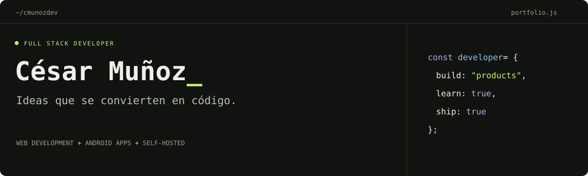

<p align="center">
  
</p>

<p align="center">
  <a href="https://cesarmunoz.dev">Portafolio</a> ·
  <a href="https://cesarmunoz.dev/en/">English</a> ·
  <a href="https://www.linkedin.com/in/cesar-daniel-munoz-dev/">LinkedIn</a> ·
  <a href="https://play.google.com/store/apps/developer?id=CDM+DEV&hl=es">Google Play</a> ·
  <a href="mailto:cesardanielmunoz@gmail.com">Contacto</a>
</p>

## Hola, soy César 👋

Soy **César Daniel Muñoz**, programador full stack y creador de productos propios. Desarrollo software a medida (páginas web, aplicaciones Android, soluciones con IA, pagos en línea y sistemas con Odoo) y me encargo de la infraestructura para llevar las ideas desde el código hasta su puesta en marcha.

Mis proyectos conectan plataformas de contenido, streaming y herramientas móviles. También trabajo con **n8n** para automatizar flujos de trabajo y conectar herramientas, y administro mi propio VPS con Docker y Dokploy.

```js
const cesar = {
  github: "@cmunozdev",
  focus: ["Custom software", "Web & Android apps", "AI solutions", "Online payments", "Odoo"],
  approach: "Pensar el producto. Construir. Seguir mejorando."
};
```

## Experiencia profesional

Desde 2016 soy **Senior Software Developer** en **Patridge Consulting**, donde contamos con **SIA Seguros**, un sistema para el sector asegurador. Compagino mi trabajo profesional con el desarrollo de mis propios productos digitales.

## Desarrollo con IA

Uso herramientas de programación con IA como Claude Code y Codex, integro modelos de IA generativa, como los de DeepSeek, mediante su API y he trabajado con agentes de IA como OpenClaw y Hermes Agent. El asistente de [cesarmunoz.dev](https://cesarmunoz.dev) funciona con un modelo de DeepSeek.

## Proyectos personales

| Proyecto | Qué puedes encontrar |
| --- | --- |
| **[Calculadora Alicia](https://play.google.com/store/apps/details?id=calculadora.de.alicia.com&hl=es)** | **Mi app destacada:** calculadora educativa con procedimiento y cálculos sin conexión, con más de 1 millón de descargas en Google Play. Desarrollada con Ionic y Angular para Android. |
| [Emisoras Dominicanas](https://emisorasdominicanas.online/) | Radio de República Dominicana organizada por emisoras, géneros y ciudades. |
| [Canales Dominicanos](https://canalesdominicanos.live/) | Catálogo de televisión y radio dominicana, con web y aplicación Android. |
| [Emisoras Colombianas](https://emisorascolombianas.online/) | Directorio de radio colombiana con búsqueda y exploración por ciudad y género. |
| [Radios de Chile](https://radiosdechile.online/) | Plataforma de radio online desarrollada con Astro y Preact. |
| [CDM DEV en Google Play](https://play.google.com/store/apps/developer?id=CDM+DEV&hl=es) | Mis aplicaciones publicadas para Android. |

También trabajo en **[EnviaSIM](https://enviasim.com/)**, una adaptación de una solución open source que conecta teléfonos Android con servicios de SMS e infraestructura propia.

## Cómo puedo ayudarte

- Desarrollo de aplicaciones web y móviles a medida.
- Páginas web a medida o con WordPress.
- Soluciones con IA generativa integrada por API: asistentes y chatbots.
- Desarrollo con Odoo, adaptado a los procesos de cada empresa.
- Pagos digitales con Azul, PayPal y Stripe: cobros en línea, transacciones y conciliación.
- Automatización de procesos e integración de herramientas con n8n.
- Bots de WhatsApp y Telegram.
- Instalación, configuración y adaptación de software open source.
- Despliegue de servicios con Docker y Dokploy en un VPS.

## Tecnologías y herramientas

| Área | Herramientas |
| --- | --- |
| Frontend | JavaScript · TypeScript · React · Astro · WordPress · Tailwind CSS |
| Backend | C# · PHP · Laravel · Python · Odoo |
| Bases de datos | SQL Server · MySQL · PostgreSQL |
| Mobile | Flutter · Dart · Ionic · Angular · Android |
| Pagos | Azul · PayPal · Stripe |
| Automatización | n8n · Flujos de trabajo · Integración de herramientas |
| Infraestructura | Docker · Linux · Dokploy · Git |

## Conversemos

¿Tienes una idea o quieres conocer cómo está construido alguno de mis proyectos?

**[cesardanielmunoz@gmail.com](mailto:cesardanielmunoz@gmail.com)**

[LinkedIn](https://www.linkedin.com/in/cesar-daniel-munoz-dev/) · [X](https://x.com/cesarmunoz06) · [Instagram](https://www.instagram.com/cesarmunoz06)
